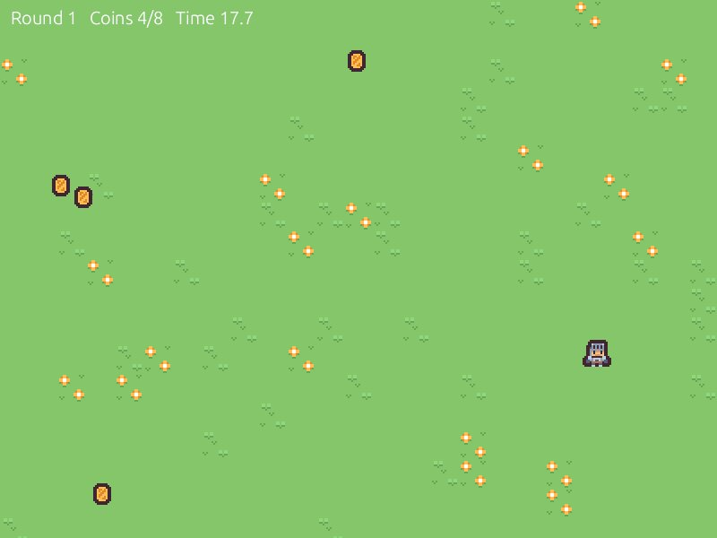
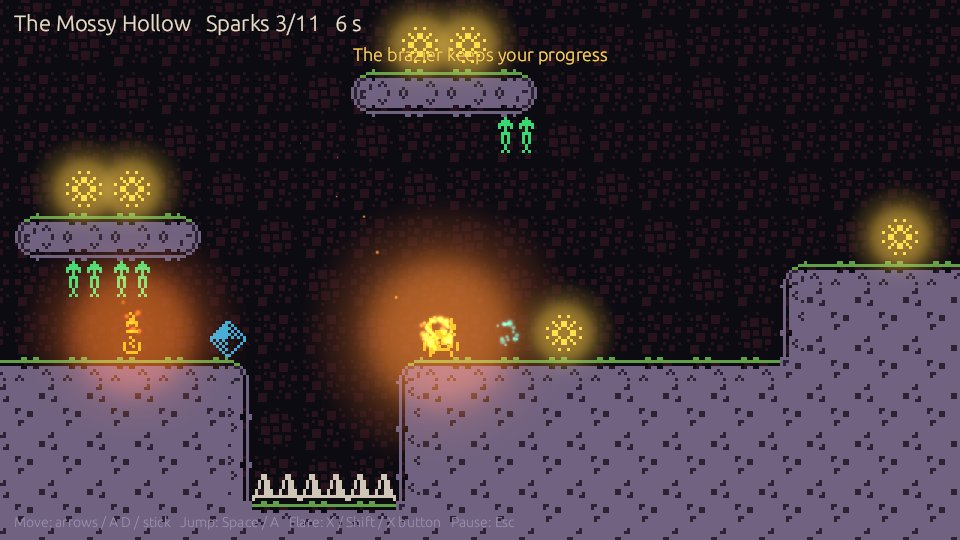

# Ponko

**A general-purpose, performance-oriented 2D/3D game engine with a code-first workflow.**

Ponko aims to provide the power of a serious game engine through clear APIs,
measured performance, and first-class support for AI-assisted development.
Large simulations are a strength, alongside ordinary 2D and 3D games: a
million entities iterate in 0.16 ms and a million units fight in 19 ms a tick
(the [numbers and how to reproduce them](#performance)).
Rust is the primary API; C and C++ bindings support native integrations.
No large visual editor is required.

[**Website**](https://ponko.dev/) · [**Guide**](https://ponko.dev/guide/) ·
[**Examples in the browser**](https://ponko.dev/guide/web.html) ·
[**API**](https://docs.rs/ponko/) · [**Project vision**](PROJECT_VISION.md) ·
[**Roadmap**](ROADMAP.md) · [**Architecture**](ARCHITECTURE.md) ·
[**Contribute**](CONTRIBUTING.md) ·
[**Discussions**](https://github.com/ponkoengine/ponko/discussions)

Formerly Crabby Engine; the [naming chapter](https://ponko.dev/guide/naming.html)
maps the old names to the new ones. Ponko is at 0.x: read
[STABILITY.md](STABILITY.md) for what a release may change and what it keeps.

## Why Ponko instead of Bevy or Unity?

The difference is the combination of choices and workflow. Individual features
such as parallel ECS queries, inspection, or AI integration are not exclusive.
The words in **bold** are [maturity levels](book/src/maturity.md): **proven**
(a reference game that the list of checks plays on Linux, macOS and Windows
uses it; [which runs are recorded](#where-the-checks-have-run)), **tested**
(automated tests, no such game yet) and **experimental** ([STABILITY.md](STABILITY.md#maturity-levels)).

| Area | Ponko today and direction | Bevy | Unity |
|---|---|---|---|
| Primary language and API | Rust `Game`/`Ctx` (**proven**); C ABI and C++17 wrapper (**tested**) | Rust, ECS-oriented `App` and systems | C# gameplay API; native engine |
| Architectural philosophy | Integrated defaults; modular internals with gradual boundary improvements planned | Modular plugins with standard defaults | Integrated editor and modular packages |
| ECS and scheduling | Archetype ECS (**proven**), parallel queries; opt-in parallel scheduling of systems that declare their access (**tested**) | ECS with automatic scheduling of compatible systems in parallel | GameObjects and optional high-performance Entities/DOTS |
| Rendering | Custom wgpu renderer: 2D **proven**, 3D **tested**; ongoing maintenance and capability work | Extensible 2D/3D renderer and render graph | Multiple render pipelines and extensive graphics tooling |
| Workflow and editor | Code-first; optional runtime inspector, editor and external asset tools (**tested**) | Code-first; no large editor required | Primarily visual-editor-centered, with code and CLI workflows |
| AI-assisted development | MCP for launch, state, stepping, screenshots and diagnostics (**tested**) | Remote protocol can support external tools and agents | Official Assistant and CLI MCP integration |
| Inspection and debugging | Reflected components, runtime inspector, logs, traces and profiling (**tested**) | Remote ECS inspection and mutation, diagnostics | Editor inspection, debugging and profiling tools |
| Headless simulation | Fixed-tick runs without a window or GPU; optional dependencies (**proven**) | Headless applications supported | Dedicated Server and batch workflows |
| Networking | Built-in lockstep, rollback, replication and message APIs (**tested**, on loopback); WebRTC **experimental**; application-specific validation required | Ecosystem networking integrations | Official multiplayer packages and services |
| Extensibility | Gameplay systems (**proven**), WGSL materials and compute (**tested**); narrower rendering boundaries planned | Plugins, systems, shaders and render extensions | Packages, scripting, native plugins and render extensions |
| Ecosystem maturity | Smaller contributor base and integration surface; verify your game's requirements | Larger Rust ecosystem and community | Much broader platform, asset, tooling and shipped-game experience |

Choose Ponko when its `Game`/`Ctx` model, integrated simulation tools, C++ API,
and inspect–step–measure loop fit your project, and you can help validate a
younger engine. It aims to become a compelling alternative to Bevy; it does
not claim overall superiority or feature parity.

Bevy may be a better fit for its established Rust ecosystem, plugin integrations,
and mature parallel scheduling. Unity may be a better fit for editor-led teams,
production tooling, platform coverage, asset workflows, and deployment experience.
Neither requires giving up performance-oriented ECS or runtime tooling.

[Full technical comparison and sources](book/src/comparison.md).
Last reviewed **2026-11-08** against official [Bevy features](https://bevy.org/),
[Bevy Remote](https://docs.rs/bevy/latest/bevy/remote/index.html),
[Unity Entities](https://docs.unity3d.com/Packages/com.unity.entities@1.4/manual/index.html),
[Unity AI](https://unity.com/features/ai), and
[Unity CLI MCP](https://docs.unity.com/en-us/unity-cli/replace-mcp-server-unity-cli).
Unity's CLI MCP replaces the deprecated in-editor Assistant MCP server.

## Start with an ordinary game

Use a recent stable Rust meeting the MSRV in `Cargo.toml`. On Linux, default
audio and gamepad features need the development headers described in the
[getting-started guide](book/src/getting-started.md).

```sh
cargo new my_game
cd my_game
cargo add ponko
```

Put a picture named `crab.png` in the project's `assets/` folder (for example
[the engine's own](https://raw.githubusercontent.com/ponkoengine/ponko/main/assets/crab.png)),
then use this in `src/main.rs`:

```rust
use ponko::prelude::*;

fn main() {
    Game::new("My Game", 800, 600).run(|ctx| {
        let sprite = ctx.gfx.load_texture("crab.png");
        let mut position = vec2(400.0, 300.0);
        move |ctx: &mut Ctx| {
            if ctx.input.key_down(Key::Right) { position.x += 200.0 * ctx.time.dt(); }
            if ctx.input.key_down(Key::Left) { position.x -= 200.0 * ctx.time.dt(); }
            if ctx.input.key_pressed(Key::Escape) { ctx.quit(); }
            ctx.gfx.draw(sprite, position);
        }
    });
}
```

Setup runs once and returns the per-frame closure. Grow into entities and
fixed-step systems when the game needs them. See the paired Rust/C++ examples
in [Getting started](book/src/getting-started.md) and the
[C/C++ guide](book/src/c-cpp.md). The native headers are `ponko.h` and
`ponko.hpp`, with the `ponko` C++ namespace.

## Scale simulation separately

Large workloads use the same engine API. This separate example moves one
million entities for 600 fixed ticks without opening a window:

```rust
use ponko::prelude::*;

#[derive(Component)]
struct Velocity(Vec2);

fn movement(ctx: &mut Ctx) {
    let dt = ctx.time.dt();
    ctx.world.query::<(&mut d2::Transform, &Velocity)>()
        .par_for_each(|(transform, velocity)| transform.position += velocity.0 * dt);
}

fn main() {
    let world = Game::new("Simulation", 1, 1)
        .sim_system(movement)
        .setup(|ctx| {
            ctx.world.spawn_batch((0..1_000_000).map(|i| (
                d2::Transform::at(vec2(i as f32, 0.0)),
                Velocity(vec2(1.0, 0.0)),
            )));
        })
        .run_headless(600);
    assert_eq!(world.len(), 1_000_000);
}
```

Use `default-features = false` for a minimal headless dependency. Running
headless alone does not disable compiled dependencies. Parallel query iteration
is tested, and systems that declare their access can opt into parallel
scheduling (`Game::parallel_systems`); `&mut Ctx` systems stay sequential. Determinism depends on game code, build/version, math and physics settings:
see [the contract](STABILITY.md#determinism).

## Current capabilities

Each feature's level is at the top of its guide chapter, and the
[maturity levels](book/src/maturity.md) page lists them all.

- **Proven** (a reference game that the list of checks plays on Linux, macOS
  and Windows uses it; the [runs recorded so far](#where-the-checks-have-run)
  are fewer than that): the ECS, systems, game states, the fixed-step clock,
  events, 2D drawing, sprite sheets and Tiled tilemaps, text and the camera,
  retained UI, named input actions, 2D physics (`physics`), scenes and
  prefabs, saves, localization, headless runs and packaging.
- **Tested** (automated tests in the list of checks; no reference game on all
  three systems yet): 3D (`3d`: PBR meshes, glTF, animation, custom WGSL
  materials, shadows, clustered lights, terrain, water, post effects), 3D
  physics and navigation meshes, sound, input devices, controllers and touch,
  networking (lockstep, rollback, replication, servers and lobbies, on
  loopback), web builds (WebGL2 in headless Chromium, Firefox and WebKit, and
  WebGPU on a real GPU; [the browser checks](web/smoke/README.md), their
  [record on a Mac](book/src/check-results/macos.md)), streaming,
  data files and asset reload,
  the inspector and editor, reflection, the control endpoint and MCP,
  profiling, and the C and C++ API.
- **Experimental:** HDR output, WebRTC, code hot patching, threaded web builds,
  and VR/XR (a [report](book/src/xr.md) and a prototype).
- **Build choices:** Cargo features select windowing, audio, inspection,
  gamepads, 3D, physics and other optional integrations. The list of checks
  ([`scripts/checks.yml`](scripts/checks.yml)) is written for Windows, macOS
  and Linux; web builds target WebGPU/WebGL2 with feature limits.

### Where the checks have run

There is no CI: a maintainer or an agent runs the list on a machine and
records the result. What is recorded today:

| System | What is recorded |
|---|---|
| macOS, Apple silicon (M4 Max, Metal) | The whole list that applies to a Mac, with the package smoke runs of the reference games and the browser checks: [check results: macOS](book/src/check-results/macos.md) |
| Windows 11, AMD (Ryzen 5 3600, Radeon RX Vega; DirectX 12 and Vulkan) | The render and example fixes found there (#494, #496, #600, #606), [Shard Grove's frame-time baseline](bench/shard_grove/windows-ryzen5-3600-rx-vega/README.md) and the [scoreboard against Bevy](book/src/performance.md#windows-desktop-ryzen-5-3600-radeon-rx-vega-directx-12-and-vulkan). A record of the whole list on Windows is not in the repository yet. |
| Linux | Nothing recorded yet: [#500](https://github.com/ponkoengine/ponko/issues/500) |

A level in this README is what the repository's tests and reference games
support; it is not a claim that every row above ran on every system. The
checks that need a person and real hardware are in
[#484](https://github.com/ponkoengine/ponko/issues/484).

The renderer already exists. Clearer resource, pipeline, scene and pass
boundaries, incremental updates, and broader validation are planned evolution,
not a renderer replacement. See [current status and gaps](ROADMAP.md).

## AI-assisted development with evidence

Install and connect the runtime tools to an MCP client:

```sh
cargo install ponko_mcp
# Example for a client supporting this command:
claude mcp add ponko -- ponko-mcp
```

A concrete workflow is to edit code, use `launch` to build/start a headless
paused example, inspect `world_summary` and reflected components, run exactly
600 ticks with `run_ticks`, then compare `entity_stats` and `system_timings`.
For visual evidence, launch with `headless: false` and use `screenshot`;
headless instances do not produce screenshots. Use `perf_report` and
`record_trace` to investigate frame cost, then rerun the same scenario.
Reflected components/resources and explicit seeds make that loop useful.

These runtime tools exist today, with an
[agent acceptance suite](book/src/agents.md#the-agent-acceptance-suite): six
game-development tasks (tuning, content, a bug, performance, a shader, UI),
each with a checker and negative controls, whose scripted solutions are
replayed through the MCP tools by `cargo test -p ponko_mcp --test agent_suite`
(18 of 18 checks in the [0.2.0 baseline](book/src/agents.md#the-020-baseline))
and again at each release ([release steps](CONTRIBUTING.md#releasing)). No run
of a real agent is recorded yet. Reliable autonomous creation of complete
games and broader machine-readable capability discovery remain development
goals. See [Working with AI agents](book/src/agents.md),
[control](book/src/control.md), and [profiling](book/src/profiling.md).

## Cookbook

[Fifty small recipes](book/src/cookbook/index.md) for what most games do. Each
is a few lines to copy, shown in Rust and C++ (two are Rust only, and say why), and each is compiled and
run headless by a test, so it cannot rot: the Rust halves by the
[`tests/cookbook_*.rs`](tests) files (one per chapter), the C++ halves by
[`examples/cpp/cookbook.cpp`](examples/cpp/cookbook.cpp) in the native check. By task:

| I want to... | Recipes |
|---|---|
| Move things | [walk](book/src/cookbook/moving.md#walk-with-the-keyboard), [gamepad](book/src/cookbook/moving.md#walk-with-a-gamepad-too), [jump](book/src/cookbook/moving.md#jump), [dash](book/src/cookbook/moving.md#dash-with-a-cooldown), [click to move](book/src/cookbook/moving.md#click-to-move), [drag](book/src/cookbook/moving.md#drag-a-sprite-with-the-mouse), [rebind keys](book/src/cookbook/moving.md#let-the-player-rebind-a-key) |
| Fight and collect | [shoot](book/src/cookbook/gameplay.md#shoot-bullets), [pick up](book/src/cookbook/gameplay.md#pick-up-coins), [damage](book/src/cookbook/gameplay.md#damage-and-death), [health bars](book/src/cookbook/gameplay.md#draw-a-health-bar), [waves](book/src/cookbook/gameplay.md#waves-of-enemies), [chase and patrol](book/src/cookbook/gameplay.md#an-enemy-that-chases-the-player), [loot](book/src/cookbook/gameplay.md#drop-loot-when-something-dies) |
| Time things | [fuses](book/src/cookbook/time.md#a-fuse-that-goes-off), [timers](book/src/cookbook/time.md#do-something-every-few-seconds), [easing](book/src/cookbook/time.md#slide-something-with-easing), [day and night](book/src/cookbook/time.md#a-day-and-a-night), [slow motion](book/src/cookbook/time.md#slow-motion) |
| Build menus | [pause](book/src/cookbook/menus.md#a-pause-menu), [title](book/src/cookbook/menus.md#a-title-screen), [game over](book/src/cookbook/menus.md#game-over-and-play-again), [HUD](book/src/cookbook/menus.md#a-heads-up-display), [volume](book/src/cookbook/menus.md#a-volume-slider), [sliding panel](book/src/cookbook/menus.md#a-panel-that-slides-in) |
| Control the camera | [follow](book/src/cookbook/camera.md#follow-the-player), [shake](book/src/cookbook/camera.md#shake-the-screen), [zoom](book/src/cookbook/camera.md#zoom-toward-the-cursor), [pixel art](book/src/cookbook/camera.md#pixel-perfect-pixel-art), [minimap](book/src/cookbook/camera.md#a-minimap) |
| Use physics | [contact damage](book/src/cookbook/physics.md#damage-on-contact), [knockback](book/src/cookbook/physics.md#knock-something-back), [line of sight](book/src/cookbook/physics.md#line-of-sight), [click a body](book/src/cookbook/physics.md#click-a-body-to-select-it), [platformer](book/src/cookbook/physics.md#a-platformer-player) |
| Work in 3D | [click an object](book/src/cookbook/three-d.md#click-a-3d-object), [walk with a camera](book/src/cookbook/three-d.md#walk-with-a-third-person-camera) |
| Load and place things | [a Tiled level](book/src/cookbook/world.md#load-a-level-from-a-tiled-map), [prefabs](book/src/cookbook/world.md#spawn-a-prefab), [attach](book/src/cookbook/world.md#attach-one-thing-to-another), [debug shapes](book/src/cookbook/world.md#draw-what-the-ai-is-thinking) |
| Add sound and saves | [footsteps](book/src/cookbook/sound-and-saves.md#footsteps), [event sounds](book/src/cookbook/sound-and-saves.md#a-sound-for-an-event), [save and load](book/src/cookbook/sound-and-saves.md#save-and-load-the-game), [settings](book/src/cookbook/sound-and-saves.md#keep-settings-and-a-best-score), [save on quit](book/src/cookbook/sound-and-saves.md#save-and-quit) |

## Examples

Most of them run in a browser too, without installing anything: the
[web chapter](https://ponko.dev/guide/web.html) tells how to build and serve the
examples, and the project's website lists the newest release's.

```sh
git clone https://github.com/ponkoengine/ponko
cd ponko
cargo run --release --example window
cargo run --release --example terrain --features 3d
AGENTS=1000000 TICKS=600 cargo run --release --example headless
```

| Example | What it demonstrates |
|---|---|
| [window](examples/window.rs) / [ui](examples/ui.rs) | Input, drawing and interface basics |
| [battle](examples/battle.rs) / [boids](examples/boids.rs) | Large simulations and spatial queries |
| [legions](examples/legions/) | 100,000 units on flow fields with spatial-grid targeting, arrows and instanced sprites; recorded battles replay to the same world hash (see [the guide](book/src/legions.md)) |
| [headless](examples/headless.rs) | Simulation without window or GPU |
| [coin_dash](examples/coin_dash/) | A small complete game: title, settings (UI scale, rebindable controls), play, pause and result screens, sound, saved best time with recovery from a damaged save, tested headlessly by `tests/coin_dash.rs`, packaged for the desktop and smoke-tested (`scripts/package-coin-dash.py`), and built for the web (see [the guide](book/src/packaging.md)) |
| [ember_hop](examples/ember_hop/) | A 2D platformer: Tiled levels, prefabs, 2D physics, animated sprite sheets, particles, streamed music and save slots (see [the guide](book/src/ember-hop.md)) |
| [shard_grove](examples/shard_grove/) | A third-person 3D game: a glTF level with PBR textures, skinned characters on an animation state machine, enemies on a navigation mesh, positional sound and saves (see [the guide](book/src/shard-grove.md)) |
| [terrain](examples/terrain/main.rs) / [shaders](examples/shaders.rs) | 3D terrain with a water-kit lake, and custom materials |
| [physics3d](examples/physics3d.rs) / [vehicle](examples/vehicle.rs) | Characters and raycast-wheel vehicles |
| [C++ examples](examples/cpp) | Native wrapper usage |


The three reference games, with CC0 art, sound and music by Kenney,
Quaternius, Poly Haven and OpenGameArt artists (credits in each game's
`CONTENT-NOTICES.txt`):

| [Coin Dash](book/src/packaging.md) | [Ember Hop](book/src/ember-hop.md) | [Shard Grove](book/src/shard-grove.md) |
|---|---|---|
|  |  |  |

The browser demo sources are in `web/`; the [web build guide](https://ponko.dev/guide/web.html)
shows how to build and serve them locally. The [website](https://ponko.dev/) has the
[guide](https://ponko.dev/guide/), and [docs.rs](https://docs.rs/ponko/) the API reference.

## Performance

Measured on 2026-11-20 on an idle MacBook Pro (M4 Max), native release builds,
at revision `e60e15a8` (the sprite and Unity rows below are older and were not
run again; the ECS row was run again on 2026-11-22 at `9235ea05`); web builds run on one thread and are slower. Reproduction commands and workload context are on the
[benchmarks page](book/src/performance.md).

| Workload | Time | Details and how to rerun |
|---|---|---|
| ECS iteration, 1M entities: Ponko / bevy_ecs / hecs | **0.16** / 0.36 / 0.70 ms | [ECS iteration](book/src/performance.md#ecs-iteration) (rerun 2026-11-22) |
| Headless simulation, 10M agents | 7.2 ms per tick | [Headless simulation](book/src/performance.md#headless-simulation) |
| Battle, 1M units: flow fields, spatial grids, fighting | 19.3 ms per tick | [Battle](book/src/performance.md#battle-the-flagship-demo) |
| Ant colonies, 1M ants | 16 ms per tick | [Ant colonies](book/src/performance.md#ant-colonies-whole-game-loop) |
| Boids, 1M, with neighbor search | ~33 ms per tick | [Boids](book/src/performance.md#boids-neighbor-search) |
| 100k events sent and read | 0.44 ms per tick | [Events](book/src/performance.md#events-and-attachments) |
| 1M moving sprites (1.6 px), rendered | 120 FPS (display cap) | [Rendering a million sprites](book/src/performance.md#rendering-a-million-sprites) (an older run) |
| 3D, 100k spinning cubes with shadows: Ponko / Unity 6 | **402** / 54 FPS (7.5x) | [3D: Ponko vs Unity](book/src/performance.md#3d-ponko-vs-unity) (an older run, shown again below) |
| Memory per entity, 1M agents | 96 bytes | [Memory](book/src/performance.md#memory) |

### Ponko vs Bevy on two machines

The [scoreboard](book/src/performance.md#ponko-vs-bevy-the-scoreboard) runs
the same workloads on Ponko and Bevy 0.20.1, release builds, the median of three
runs. It has been run on a MacBook Pro (M4 Max, Metal) and on a [Windows 11
desktop](book/src/performance.md#windows-desktop-ryzen-5-3600-radeon-rx-vega-directx-12-and-vulkan)
(Ryzen 5 3600, Radeon RX Vega, DirectX 12 and Vulkan; run-time rows
only, on a machine that other jobs were also using). A selection, in ms per frame or tick:

| Workload | M4 Max, Metal: Ponko / Bevy | Windows, DX12: Ponko / Bevy | Windows, Vulkan: Ponko / Bevy |
|---|---|---|---|
| Sprites, 100k moving | **1.10** / 11.6 | **2.91** / 29.2 | **2.48** / 30.2 |
| Sprites, 100k with a tint each | **1.09** / 44.8 | **2.84** / Bevy failed (GPU out of memory) | **2.53** / 90.3 |
| 3D, 100k moving meshes with a sun shadow | **4.63** / 15.8 | **15.6** / 39.7 | **14.8** / 31.2 |
| 3D, 1,000 skinned characters | 6.06 / **3.86** (Bevy faster) | **9.65** / 15.5 | 8.72 / **8.35** (Bevy faster) |
| 2D physics, 10k boxes | **6.39** / 8.11 | **26.2** / 34.3 | **25.6** / 31.5 |
| UI, 10k nodes | **1.63** / 4.58 | **5.34** / 12.7 | **4.35** / 12.1 |
| ECS, iterate 1M | **0.165** / 0.390 | **0.522** / 1.19 | **0.426** / 0.962 |

Linux and an integrated GPU are not measured yet (#501).

### 3D: Ponko vs Unity 6

The documented workload uses N spinning, tinted cubes, 12 PBR spheres, a sun
with soft shadows and 4x MSAA. The Unity implementation uses one GameObject
with an `Update()` script per cube and URP. Fullscreen, native resolution,
vsync off, M4 Max, median of three 10-second runs. Implementation and rendering
differences are detailed in the linked notes.

| Spinning cubes | Unity 6 | Ponko | CPU per frame: Unity / Ponko |
|---|---|---|---|
| 1,000 | 728 FPS | **750 FPS** | 0.65 / **0.17** ms |
| 10,000 | 398 FPS | **724 FPS** (1.8x) | 2.51 / **0.43** ms |
| 100,000 | 54 FPS | **402 FPS (7.5x)** | 18.7 / **2.48** ms |

What's not equal, and how to rerun both sides, is on the
[benchmarks page](book/src/performance.md#3d-ponko-vs-unity).

The Unity comparison above and the sprite row come from an earlier version and
were not run again on 2026-11-20. The Unity comparison uses GameObjects
with per-object `Update`, not Entities/DOTS; it does not establish a general
engine ranking. GPU feature parity, scene differences, dependency versions,
and workload details matter. Consult the linked reproduction notes before
using a number to choose an engine.

## Modular internals, integrated experience

Common things should work immediately. Advanced things should be customizable.
Neither should require understanding the entire engine. Existing Cargo features
provide compile-time choices; internal module boundaries and selective extension
APIs should improve maintainability without a mandatory plugin assembly step.
New crates and abstractions need concrete benefits. This is an architectural
direction, not a claim that every subsystem is already decoupled.

## Contributing and compatibility

Start with [CONTRIBUTING.md](CONTRIBUTING.md), [the roadmap](ROADMAP.md),
and [coding-agent rules](AGENTS.md). Performance changes need representative
measurements; correctness and compatibility come first. The
[stability policy](STABILITY.md) covers the API and ABI, saved worlds,
MCP contracts and determinism within its stated scope.

Questions, ideas and things you made go to
[GitHub Discussions](https://github.com/ponkoengine/ponko/discussions). How
decisions are made, and how quickly the maintainers aim to answer, is in
[GOVERNANCE.md](GOVERNANCE.md).

Follow the [code of conduct](CODE_OF_CONDUCT.md). Report vulnerabilities through
[SECURITY.md](SECURITY.md).

## License

Created by Leon Mamić and contributors; see [NOTICE](NOTICE).
Dual licensed under [MIT](LICENSE-MIT) or [Apache-2.0](LICENSE-APACHE), at your option.
Unless explicitly stated otherwise, contributions intentionally submitted for
inclusion are licensed under both on the same terms.
