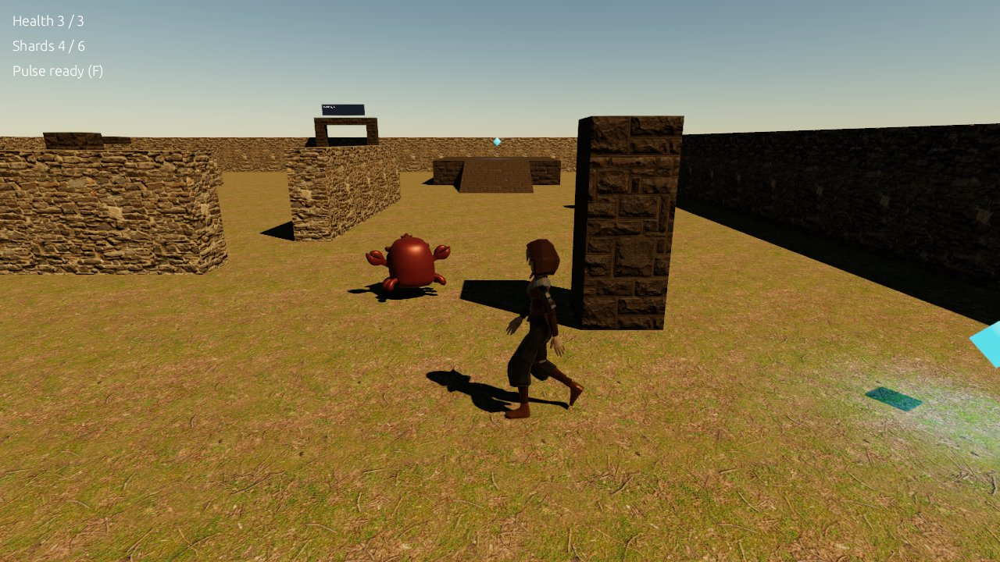

# Ponko

Ponko is a free, open-source Rust engine for 2D and 3D games that you write
as plain code, with rendering, physics, UI, audio and networking in one crate.

[](https://crates.io/crates/ponko)
[](https://docs.rs/ponko/)
[](#license-and-credits)

| [Coin Dash](book/src/packaging.md) | [Ember Hop](book/src/ember-hop.md) | [Shard Grove](book/src/shard-grove.md) |
|---|---|---|
|  |  |  |

The three reference games ship with the engine as examples, and the test suite plays them.

## Try it

You need Rust 1.95 or newer. On Linux, also `libasound2-dev` and `libudev-dev`
([Getting started](book/src/getting-started.md) has the details).

```sh
cargo install ponko_cli --version 0.2.0-rc.1
ponko new my_game
cd my_game && cargo run
```

The guide documents 0.2, and 0.2.0 is not released yet: until it is, the
commands name the release candidate. Without it, `cargo add ponko` gives
0.1.0, and `cargo install ponko_cli` finds no version.

To start by hand, run `cargo new my_game && cd my_game && cargo add ponko@0.2.0-rc.1`,
save a picture as `assets/crab.png` next to `Cargo.toml` (for example
[the engine's own](https://raw.githubusercontent.com/ponkoengine/ponko/main/assets/crab.png)),
and put this in `src/main.rs`:

```rust
use ponko::prelude::*;

fn main() {
    Game::new("My Game", 800, 600).run(|ctx| {
        let sprite = ctx.gfx.load_texture("crab.png");
        let mut position = vec2(400.0, 300.0);
        move |ctx: &mut Ctx| {
            if ctx.input.key_down(Key::Right) { position.x += 200.0 * ctx.time.dt(); }
            if ctx.input.key_down(Key::Left) { position.x -= 200.0 * ctx.time.dt(); }
            if ctx.input.key_pressed(Key::Escape) { ctx.quit(); }
            ctx.gfx.draw(sprite, position);
        }
    });
}
```

Most examples also build for the web: `web/build.sh battle` writes
`target/web/battle/`, ready to serve ([Web builds](book/src/web.md) lists what
it needs). A hosted gallery of them is planned; it is not online yet.

## What you get

The word in bold is the feature's [maturity level](book/src/maturity.md).

- **Proven:** an archetype ECS, systems and a fixed-step clock ([Entities, components, queries](book/src/ecs.md)).
- **Proven:** 2D drawing, sprite sheets, Tiled tilemaps, text and the camera ([Drawing](book/src/drawing.md)).
- **Proven:** 2D physics; **tested:** 3D physics, characters and vehicles ([Physics](book/src/physics.md), [3D physics](book/src/physics3d.md)).
- **Tested:** a 3D renderer with PBR materials, glTF, skinned animation, shadows, terrain and water ([3D](book/src/3d.md)).
- **Proven:** retained UI, saves and headless runs; **tested:** sound ([UI](book/src/ui.md), [Headless runs and testing](book/src/headless.md), [Sound](book/src/audio.md)).
- **Tested:** lockstep, rollback and replication on loopback; web builds; a C API and C++17 wrapper ([Multiplayer](book/src/multiplayer.md), [Web builds](book/src/web.md), [C and C++](book/src/c-cpp.md)).

## Measured

Three rows of the [scoreboard against Bevy 0.20.1](book/src/performance.md#ponko-vs-bevy-the-scoreboard)
([`bench/compare/results/scoreboard.md`](bench/compare/results/scoreboard.md)):
a MacBook Pro with an Apple M4 Max, macOS 27.2.1, Metal, release builds, the
median of three runs, in milliseconds per frame or tick.

| Workload | Ponko | Bevy | Measured |
|---|---:|---:|---|
| ECS: iterate 1M entities (one archetype) | 0.165 | 0.390 | 2026-11-22, `5e5af4ee` and uncommitted changes |
| Sprites: 100k moving, one frame drawn | 1.10 | 11.6 | 2026-11-22, `5e5af4ee` and uncommitted changes |
| 3D: 1,000 skinned characters with a sun shadow | 2.38 | 3.83 | 2026-11-26, `431fae00` |

Bevy is ahead in places: on a Windows desktop with Vulkan it draws the
skinned characters faster (8.35 against 8.72 ms), and it has a pipelined
renderer, which Ponko lacks. The [method](bench/compare/README.md), the
other rows and the Windows tables are on the
[benchmarks page](book/src/performance.md).

## Status, and when not to use it

Ponko is at 0.2.0-rc.1, the candidate for 0.2.0 (2026-11-28). Its first
commit is from 2026-11-02 and its first release, 0.0.1, from 2026-11-08.
[STABILITY.md](STABILITY.md) says what a release may change.

There is no CI: a maintainer runs the list of checks
([`scripts/checks.yml`](scripts/checks.yml)) on a machine and records the
result. What is recorded today:

| System | What is recorded |
|---|---|
| macOS, Apple silicon (M4 Max, Metal) | The whole list that applies to a Mac, with the package smoke runs of the reference games and the browser checks: [check results: macOS](book/src/check-results/macos.md) |
| Windows 11, AMD (Ryzen 5 3600, Radeon RX Vega; DirectX 12 and Vulkan) | The render and example fixes found there (#494, #496, #600, #606), [Shard Grove's frame-time baseline](bench/shard_grove/windows-ryzen5-3600-rx-vega/README.md) and the [scoreboard against Bevy](book/src/performance.md#windows-desktop-ryzen-5-3600-radeon-rx-vega-directx-12-and-vulkan). A record of the whole list on Windows is not in the repository yet. |
| Linux | Nothing recorded yet: [#500](https://github.com/ponkoengine/ponko/issues/500) |

When not to use Ponko:

- You want a visual editor. Use Godot.
- You want a large ecosystem of plugins, tutorials and people to ask. Use Bevy.
- You need the API to stay put. Ponko is 0.x: 0.1.0 and 0.2.0 each break code
  written for the release before ([migrating to 0.2](book/src/migrating-to-0.2.md)),
  and later releases will too.
- You are shipping on consoles or phones. Consoles are not supported; iOS and
  Android build but are not validated.
- You need Linux to be a tested target today. It is supported in code, and no
  full run of the checks is recorded on it yet (#500).
- You need an engine with shipped games and more than one maintainer behind
  it. Ponko has neither yet.

## Learn

- [The guide](https://ponko.dev/guide/) ([source](book/src/SUMMARY.md)), starting with [Getting started](book/src/getting-started.md)
- Tutorials: [a first 2D game](book/src/tutorial-2d.md), [a first 3D game](book/src/tutorial-3d.md)
- [The cookbook](book/src/cookbook/index.md): fifty small recipes, each compiled and run by a test
- [The examples](examples/README.md), grouped by area
- [The API reference](https://docs.rs/ponko/) on docs.rs
- [Coming from Bevy](book/src/from-bevy.md) and [Ponko vs Bevy vs Unity](book/src/comparison.md)
- [Project vision](PROJECT_VISION.md), [roadmap](ROADMAP.md) and [architecture](ARCHITECTURE.md)

## Community and contributing

Questions, ideas and things you made go to
[GitHub Discussions](https://github.com/ponkoengine/ponko/discussions).
To make a first change, pick a
[good first issue](https://github.com/ponkoengine/ponko/labels/good%20first%20issue)
and read [CONTRIBUTING.md](CONTRIBUTING.md). [GOVERNANCE.md](GOVERNANCE.md)
says how decisions are made and how soon the maintainers aim to reply. Follow
the [code of conduct](CODE_OF_CONDUCT.md), and report vulnerabilities as
[SECURITY.md](SECURITY.md) says.

## How Ponko is developed

Ponko has one maintainer, Leon Mamić, who directs and reviews the work; one
other person has contributed changes so far. Much of the code is written by AI
coding agents under that direction, and most commits on `main` name an agent
as co-author. Every change passes the same checks whoever wrote it, as
[AGENTS.md](AGENTS.md) and [`scripts/checks.yml`](scripts/checks.yml) list
them: formatting, `cargo test --workspace`, clippy with warnings denied, Miri
for the unsafe code in the ECS and elsewhere, AddressSanitizer and
UndefinedBehaviorSanitizer for the C API, the fuzz targets in
[`fuzz/`](fuzz/README.md), and the guide's code snippets. There is no CI: the
checks run on maintainers' machines, and the runs are recorded in the guide
([check results: macOS](book/src/check-results/macos.md)).

## Tools for coding agents

- `ponko-mcp` is an MCP server: an agent can launch a game headless, step it, and read and change its components.
- It also takes screenshots, profiles frames and records traces.
- `ponko new` writes an `AGENTS.md` into every new project, and an `.mcp.json` that registers the server into every new game.
- An acceptance suite of six game-development tasks checks the tools at each release.
- [Working with AI agents](book/src/agents.md) has the setup and the recorded runs.

## License and credits

Created by Leon Mamić and contributors; see [NOTICE](NOTICE). Dual licensed
under [MIT](LICENSE-MIT) or [Apache-2.0](LICENSE-APACHE), at your option.
Unless explicitly stated otherwise, contributions intentionally submitted for
inclusion are licensed under both on the same terms.

The reference games use CC0 art, sound and music by Kenney, Quaternius, Poly
Haven and OpenGameArt artists (credits in each game's `CONTENT-NOTICES.txt`).

Formerly Crabby Engine; the [naming chapter](book/src/naming.md) maps the old names to the new ones.
