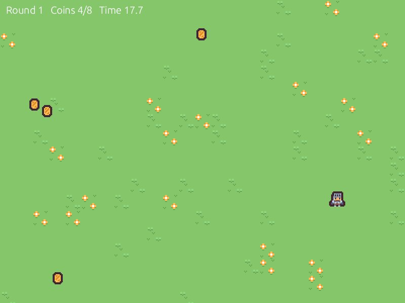

# A complete game, packaged

> **Maturity: [proven](maturity.md).** Game: Coin Dash and Ember Hop, packaged
> and played on Linux, macOS and Windows; Shard Grove packages, but its
> package is not played. Tests: `scripts/package-coin-dash.py selftest` and
> the package smoke runs. Platforms: Linux, macOS and Windows (the
> `package-smoke` job). Graphics: the packaged games run in a window on Linux
> (software Vulkan under Xvfb), macOS and Windows (DirectX 12, WARP when there
> is no GPU); Coin Dash also runs in headless Chromium and WebKit on WebGL2.

[`examples/coin_dash`](../../examples/coin_dash)
is the engine's reference for a small *finished* game: title screen, settings,
rounds with a win and a loss, pause, restart, result screens, sound, saved
progress, keyboard and gamepad, and a download you can unzip anywhere. It uses
only the public `Game`/`Ctx` API, three pictures (`assets/coin_dash/coin.png`,
`player.png` and `field.png`, tiles from Kenney's Tiny Town and Tiny Dungeon),
sound effects from Kenney's sound packs, a chiptune by Juhani Junkala (all
CC0), and the engine's built-in fonts.


 Rules and tests are described in
[Headless runs and testing](headless.md#a-complete-game-tested-headlessly);
this chapter is about getting it to players and what it shows, starting with
the command that packages any game.

## Packaging any game: `ponko package`

`ponko package` turns a game into what players download, with one command in
the game's folder (`cargo install ponko_cli` gives the `ponko` command; in the
engine's repository, `cargo run -p ponko_cli -- package` runs it):

```sh
cd my_game
ponko package                 # for this computer: zip, app in a dmg, or tar.gz
ponko package --web           # a folder to put on any static web host
ponko package --web --threads # the same, with threads where the host allows them
```

It builds the game in release, packs its assets into one file, collects its
license files, writes `THIRD-PARTY-NOTICES.txt` for every library linked into
it, lays the package out for the platform, archives it, and starts the
packaged copy once to check it runs (the [smoke run](#the-smoke-run-of-any-package)). Everything goes to
`target/package/` (`--out` elsewhere), named
`<name>-<version>-<os>-<arch>`, for example `coin-dash-0.1.0-macos-aarch64`:

| Platform | Layout | Archive (default) |
|---|---|---|
| Windows | a folder: `my_game.exe`, `assets.pack`, the licenses and notices | `.zip` |
| macOS | `My Game.app` (the program in `Contents/MacOS`, `assets.pack`, licenses and notices in `Contents/Resources`, the icon as `icon.icns`, an `Info.plist`), with the licenses and notices also beside the app | `.dmg` with a link to Applications (made with `hdiutil`, so on a Mac; elsewhere a `.zip`) |
| Linux | a folder, like Windows' | `.tar.gz` |
| Web (`--web`) | a folder: `index.html`, `game.js`, `game_bg.wasm`, `assets.pack`, the licenses and notices | none: upload the folder |
| iOS (`--target ios`, `--target ios-sim`) | `My Game.app`, a flat iOS bundle: the program, `assets.pack`, the icons, an `Info.plist`, the licenses and notices (see [iOS](ios.md)) | `.ipa` for a device, `.zip` for the simulator |
| Android (`--target android`) | the files of the apk in `apk/`: `AndroidManifest.xml`, the program as `lib/arm64-v8a/libmain.so`, `assets/assets.pack`, the icons, the licenses and notices; the licenses and notices also beside it (see [Android](android.md)) | `.apk`, signed with the debug key (or by the signing hook) |

`--format` picks others (comma-separated `zip`, `tar.gz`, `dmg`, `ipa` (iOS
devices), `apk` (Android), or `folder`: the plain folder without archive, and on macOS without
app bundle). The zip and
tar.gz files are written by the command itself, so no `zip` or `tar` program is
needed on any OS, and they are reproducible: entries sorted, owned by root,
with fixed dates, so packing the same files twice gives the same bytes. The
engine finds the assets next to the program, and inside an app bundle in
`Contents/Resources` ([below](#the-package)), so an unpacked game works from any
folder. The files under `assets/` ship as one asset pack, `assets.pack`
([below](#assets-in-one-pack-ponko-pack)); `--no-pack` ships them as loose
files in `assets/` instead, [cooked](#cooking-assets-ponko-cook) all the same.

### What goes in: `[package.metadata.ponko]`

The game's `Cargo.toml` says what to ship. Projects from `ponko new` have the
table already; every key is optional:

```toml
[package.metadata.ponko]
name = "My Game"              # the name players see: the app, the web page's title, the file names (my-game-...)
id = "com.example.my-game"    # a reverse-DNS id you own: the macOS and iOS bundle identifier, the Android package
icon = "assets/icon.png"      # a square PNG of 16 to 1024 pixels (a power of two; 512 or 1024 looks best)
orientation = "any"           # phones (iOS, Android): any, landscape or portrait
assets = ["assets"]           # folders or files, shipped at the same path next to the program
pack = { exclude = ["**/*.psd"] }  # how files under assets/ go into assets.pack (or pack = false: loose)
files = [                     # put at the package's top: licenses, a readme for players, notices
    "LICENSE-MIT",
    { from = "docs/PLAYER-README.txt", to = "README.txt" },
    { from = "docs/manual.pdf", to = "docs/manual.pdf" },  # `to` can name a folder inside the package
]
```

| Key | Default |
|---|---|
| `name` | the package's name (an example's name for `--example`) |
| `id` | `local.<name>`, with a note to set one |
| `icon` | none: macOS shows the generic app icon |
| `orientation` | `any`: an iOS or Android app turns every way the device does (iPhones not upside down), within the player's rotation lock |
| `assets` | `["assets"]` if that folder exists, else nothing; hidden files (`.DS_Store`) are left out |
| `files` | the `LICENSE*`, `LICENCE*`, `COPYING*`, `NOTICE*` files beside `Cargo.toml`; a path is put at the package's top under its file name, `{ from, to }` at `to`: a file name or a path inside the package such as `docs/README.txt` (`/`-separated, no `..`), made in each place the package has its files (on macOS inside the app's `Resources` and beside the app) |
| `pack` | `true`: the files under `assets/` in one `assets.pack`, [cooked](#cooking-assets-ponko-cook); `false` ships them loose; a table sets packing up: `exclude` (patterns of files left out), `textures = true` (images converted to KTX2 per `textures.json`, as `ponko pack --textures`) and `cook = false` (the source files as they are) |

Paths are relative to `Cargo.toml`. An unknown key, an id that isn't reverse
DNS, a missing file, two files at one place in the package and a file where
another needs a folder are errors that name the key. For an example of a package (`--example <name>`),
`[package.metadata.ponko.examples.<name>]` takes the same keys and overrides
the table above it; this repository's root `Cargo.toml` describes Coin Dash
that way.

The other options follow Cargo: `--bin <name>` or `--example <name>` (by
default the package's only binary, or its `default-run`), `-p <package>` in a
workspace, `--manifest-path`, `--features`, `--no-default-features`,
`--profile <name>` (default `release`), `--locked`, and `--no-build` to
package what is already built (honouring `CARGO_BUILD_TARGET`). `ponko help
package` lists them all.

### Smaller downloads: the `dist` profiles

`--profile <name>` builds with another Cargo profile than `release`. The
templates have two made for downloads: `dist` (fat LTO, one codegen unit,
symbols stripped; still `opt-level = 3`) and `dist-web` (the same optimized
for size, without `strip`, which wasm-bindgen needs):

```sh
ponko package --profile dist                # desktop
ponko package --web --profile dist-web      # the web folder
```

For the 2D template on macOS, `dist` makes the program 14.8 MB instead of
24.5 MB (19.4 MB stripped) and takes 2 min 18 s to build instead of 36 s;
`dist-web` makes the `.wasm` 10.2 MB instead of 15.1 MB. The numbers and the
other settings that were tried are in [Build times and download
sizes](performance.md#download-sizes). A project made by hand adds the
profiles to its `Cargo.toml`:

```toml
[profile.dist]
inherits = "release"
lto = "fat"
codegen-units = 1
strip = true

[profile.dist-web]
inherits = "release"
lto = "fat"
codegen-units = 1
opt-level = "s"
```

### Assets in one pack: `ponko pack`

A shipped game reads its assets from one **asset pack**, `assets.pack`, where
its `assets/` folder would be: next to the program, in a macOS app's
`Contents/Resources`, next to the web page. `ponko package` writes it from the
files under `assets/` (asset files elsewhere stay loose beside it), and the
game reads it without a line of code: when a name isn't found as a loose file
in an `assets/` folder, the engine looks in the `assets.pack` beside each of
those folders. In development nothing changes: the loose files are found
first, so they keep [hot reload](drawing.md#hot-reload), and a loose file
beside a pack overrides the packed one.

`ponko pack` makes a pack on its own, for a pipeline of your own or a pack of
downloadable content that the game adds as a source
([`PackSource`](asset-sources.md#packs)):

```sh
ponko pack                                  # assets/ -> target/assets.pack
ponko pack art --out dist/forest.pack --exclude '**/*.psd'
ponko pack --textures                       # with the images converted to KTX2 per assets/textures.json
ponko pack --list target/assets.pack        # what a pack holds, checksums checked
```

A pack has an index (each file's name, size and CRC-32) followed by the
files, each stored as it is or deflated: a file is deflated when that makes
it at least a tenth smaller, and PNG, JPEG, Ogg and other compressed formats
are stored. Identical files are stored once. Names are sorted and nothing
records when or where the pack was made, so packing the same files gives the
same bytes, and a reproducible build stays reproducible. `--textures` runs
the conversion of [`ponko textures`](drawing.md#compressed-textures) on the way,
into the pack instead of next to the images: each image whose
`textures.json` kind isn't `skip` also goes in as a `.ktx2` of the same name
(a `.ktx2` already in the folder and newer than its image and settings is
packed as it is). The game decides which name it loads; `--exclude` leaves
out the images it no longer needs. The format is documented in the engine's
`src/assets/pack.rs`; the engine reads version 1 and says so when given
another.

The engine reads a pack file a file at a time (only the index is read when
it opens), unpacks each file when it is loaded and checks its CRC-32, so a
damaged pack fails with the name of the damaged file instead of loading
garbage. On the web the page's pack is fetched before setup with at most two
HTTP range requests: the first 64 KiB, which hold the index (and all of a
small pack), then the rest; a server without range support sends the whole
pack in answer to the first. C and C++ games get the default `assets.pack`
the same way; `PackSource` itself has no C or C++ binding yet (a C game can
read a pack of its own through `ponko_ctx_add_asset_source`).

### Caps on what a pack may unpack to

A deflate stream can expand about a thousandfold, so a ratio check alone
doesn't bound a pack: 100 MiB of zeros inside it would unpack to about 100 GiB.
The engine adds three absolute caps, counted on the bytes it actually
produces and not on what the index claims:

| Cap | Default | Checked |
|---|---|---|
| `max_entry_size`: one file | 1 GiB | when the file is read, and while it inflates: it stops at the cap and never holds more |
| `max_pack_size`: the sizes the index declares, added up | 16 GiB | when the pack is opened |
| `max_entries`: files in the index | 1,000,000 | when the pack is opened |

An error names the file, the cap and how to raise it. A game that loads
packs from players or the network sets them low, a game shipping a very large
pack of its own raises them, with the other settings on `Game` (they cover
`assets.pack`, mod packs and every `PackSource::open` and `from_bytes`), or for
one pack on its own:

```rust
# use ponko::prelude::*;
use ponko::assets::{PackLimits, PackSource};

# fn main() -> Result<(), ponko::prelude::Error> {
// Packs from players: 8 MiB a file, 32 MiB and 500 files a pack.
let strict = PackLimits::default()
    .with_max_entry_size(8 << 20)
    .with_max_pack_size(32 << 20)
    .with_max_entries(500);
let game = Game::new("Sharing", 1280, 720).pack_limits(strict);

// Or one pack alone, with its own caps:
# let bytes: Vec<u8> = Vec::new();
let pack = PackSource::from_bytes_with_limits("download", bytes, PackLimits::default().with_max_entries(100));
# let _ = (game, pack);
# Ok(())
# }
```

The tools keep to the same defaults: `ponko pack`, `ponko cook --pack` and
`ponko package` refuse to write a pack that the engine's defaults would refuse
to read, naming the file and the cap. A game that really needs more gives the
caps to the tool (`--max-entry-size`, `--max-pack-size` in bytes or with
`KiB`, `MiB`, `GiB`, and `--max-entries`) and raises them in the game with
`Game::pack_limits`; `ponko cook --pack art --max-pack-size 32GiB`.

What a pack saves on the web, measured on Ember Hop's web package (26 asset
files, 248 KiB loose, 170 KiB packed), five runs each in headless Chromium on
an emulated network with `node web/smoke/first-load.mjs` (HTTP/1.1, cache
off, on a laptop that was compiling at the same time; medians, runs within
about 40 ms of each other):

| Network | | Requests (for assets) | Asset phase | First frame |
|---|---|---|---|---|
| no throttling | loose | 30 (27) | 12 ms | 98 ms |
| | packed | 5 (2) | 2 ms | 80 ms |
| 40 ms, 20 Mbit/s | loose | 30 (27) | 292 ms | 6335 ms |
| | packed | 5 (2) | 167 ms | 6215 ms |
| 150 ms, 5 Mbit/s | loose | 30 (27) | 1055 ms | 24968 ms |
| | packed | 5 (2) | 591 ms | 24502 ms |

The asset phase runs from the first asset request to the last asset byte:
it falls by more than 40% on both emulated networks, and 81 kB fewer bytes
arrive. The first frame barely moves because the 14 MB release `.wasm`
(built without `wasm-opt`) takes most of the time; a game with more assets
gains more, and the request count falls from one per file to two whatever
their number.

### Cooking assets: `ponko cook`

Source assets are made for editing; a shipped game wants them ready to
load. `ponko cook` turns a folder of them into runtime-ready files **under
the same names**, and `ponko package` cooks the files it puts in
`assets.pack`. The engine finds a texture's, sound's and model's format from
its first bytes, so a cooked `bricks.png` that holds KTX2 blocks still loads
with `ctx.gfx.load_texture("bricks.png")`: the game's code doesn't change.
While you work, games run the source files in `assets/` directly, with hot
reload; nothing needs cooking to iterate.

```sh
ponko cook                              # assets/ -> target/cooked/desktop/
ponko cook --platform mobile            # textures as Basis Universal UASTC
ponko cook art --pack dist/art.pack     # one asset pack of the cooked files
ponko pack --cook                       # the same, as ponko pack's option
```

| Source | Cooked | Kept as it is when |
|---|---|---|
| PNG, JPEG | KTX2 with a full mip chain: BC7 for colors (sRGB) and data, BC5 for normal maps, BC4 for masks on `desktop` and `web`; Basis Universal UASTC on `mobile` (transcoded at load to ASTC 4x4, ETC2 or BC7). An image file a glTF model reads (its `uri`) is cooked for its use there, whether the model is cooked or kept: base color BC7 sRGB, normal map BC5, metallic-roughness BC7 with the occlusion merged in ([below](#model-image-files)) | a glTF model reads it with two uses (one texture as color and as data), as the occlusion merged into a metallic-roughness file, or beside an image inside the model; 16 bits per channel (a height map), sides not multiples of 4, or the game reads no KTX2 |
| glTF, GLB | one GLB: triangles reordered for the vertex cache and for overdraw, vertices in the order they are first used (meshoptimizer), unused vertices dropped; normals as 16-bit and texture coordinates in 0..1 as 16-bit unsigned integers (`KHR_mesh_quantization`, an error under 2e-5); positions as 16-bit integers when that moves none by more than 0.1 mm (one range for a mesh up to 13 m across, else one per primitive up to 13 m; [below](#quantized-positions)); the images a GLB holds as KTX2 for their use (`KHR_texture_basisu`): base color BC7 sRGB, normal map BC5, metallic-roughness BC7 with the occlusion merged in, as the engine merges it; UASTC on `mobile`; a `.gltf` file's `.bin` buffers stay out, as the GLB holds them | compressed geometry (meshopt, Draco) keeps its buffer layout while eligible embedded images are compressed; models with an unknown extension are copied; vertices that two primitives share keep their order; positions of skinned, instanced or morphed meshes, of primitives past 13 m and of shared position data; images with two uses (one texture as color and as data), 16 bits or sides not multiples of 4 (images in their own files are cooked as images, above) |
| Aseprite (`.aseprite`, `.ase`) | the JSON Array export and PNG sheet [`load_aseprite`](drawing.md#sprites-and-animations-from-aseprite) reads, `hero.json` and `hero.png` beside it, made without Aseprite: frames composited with group, layer and cel opacity and blend modes, embedded tilemaps, durations, tags with direction and repeats, slices with their pivot and nine-slice center; `"layers": true` exports each visible layer (`--split-layers`); the sheet is then cooked as any PNG | `"keep"`; a file the cook can't read fails it. An export already beside it is replaced by the one the cook makes |
| WAV (8, 16, 24-bit PCM) | FLAC: lossless, smaller | float or 32-bit samples |
| WGSL | the same file, checked: the engine's own rules for its kind (the hook's signature, no entry points and no bindings of its own), then composed with the engine's code for its kind (found from its hook: `vertex`/`surface`, `fragment`, `sky`, `effect`, `compute`) and validated with naga, as the engine does at load; an error names the file's own line | `"shader": "keep"` |
| anything else | copied | |

A model's nodes, materials, animations, skins and every `extras` are written
back as they were read: only the mesh data and the images change. A shader,
model or sound that can't be cooked fails the cook with every such file and
the reason.

<a id="quantized-positions"></a>**Quantized positions.** 16-bit positions
count steps across the mesh's bounds, so they need a scale and an offset.
The cook puts them on a new child node that shows the mesh (marked
`PONKO_quantized_positions`) and takes the mesh off its node; the engine
folds that child back as it loads, so game code sees the source's tree:
`GltfScene` nodes, their names, parents, transforms, `extras` and the
colliders, bodies and spawn points made from them are the same, and every
position (in `load_mesh_data`, mesh colliders, a navigation mesh baked from
the level) is within 0.1 mm of the source's. A tool that reads the cooked
file without the engine sees the extra node with its scale.
A mesh larger than one 16-bit range holds within the bound (a level made of
tiles, 13.1 m) gets a range per primitive instead: each primitive that fits
gets its own child node and mesh (marked with the source mesh and its
primitives), and primitives too large for one stay floats on one more
child. The engine puts the primitives back in one mesh, in their order,
each with its own scale. A 48 m test level of 16 primitives (1,089 corners
each) is 627,716 bytes with float positions and 561,256 bytes with a range
per primitive (the test `a_level_too_big_for_one_range_gets_a_range_per_primitive`).
`"quantize": false` keeps a model's positions and normals as floats.

**Embedded images in compressed models.** When the game reads KTX2, the
cook compresses eligible images inside meshopt and Draco models using the
same texture rules as other models. It preserves the original buffers and
view layout, including external buffer references, and adds the KTX2 data
alongside them. The bytes of each image it replaced are dropped from the
buffers the model holds itself (a GLB's own chunk, a data URI), so the
file is smaller on disk, not only once packed. Every view and compressed
stream after them moves down by a multiple of 16 bytes, which keeps its
alignment, and its bytes stay the same: the geometry is byte for byte the
source's. Each run of dropped image bytes keeps 1 to 16 zeroed bytes, so
the views nothing reads any more stay valid. An image in an external
`.bin` is shortened the same way when the cook knows one model reads that
file (no other model names it, and no rule keeps or skips it): the cook
writes the shorter file in the model's place and rewrites the model's
offsets, and the cook's line for the `.bin` says which model's images it
lost. A buffer two models read stays as it is, since each model alone
can't tell what in it is unused; so does one a `keep` rule covers. The
meshopt fixture of `tests/fixtures/cook-kept` (three 32 x 32 PNGs and
their occlusion, 4,067 bytes, replaced by 2,844 bytes of KTX2) went from
7,116 bytes to 10,188 with the images zeroed, and is 6,128 bytes now. The
same model with its chunk in an external `.bin` (`geometry.bin`, 4,364
bytes, and a `.gltf` file of 6,831 bytes, together 11,195) is a `.gltf` file
of 6,809 bytes and a `.bin` of 316: 7,125 bytes, where its source was 7,112.
The engine then uploads the KTX2 images as GPU blocks and still
decompresses the geometry at load (feature `gltf-meshopt`). Set a model's
`texture` rule to `keep` to keep its embedded textures, or use the `keep`
rule to copy the whole model verbatim.

<a id="model-image-files"></a>**A model's image files.** The cook reads each
glTF model's materials and cooks the image files they name for their use:
the base color as sRGB, the normal map as BC5, and the metallic-roughness
image as linear BC7 with the occlusion image merged into its red, the ORM
image the engine would otherwise merge on the CPU at load. The merged file
keeps its name and carries a `ponkoOrm` key naming both sources; when a
model's material names the same two files, the engine uploads it as it is,
in blocks, and doesn't read the occlusion file. That works for a model the
cook keeps as it is too (`"keep"`, or one with an extension the cooker
doesn't rewrite), so its occlusion no longer costs RGBA8. The occlusion file
is kept as it is, for any other reader. The fixture model of
`model_textures_render_test` (32 x 32 base color, normal map,
metallic-roughness and occlusion files, the model itself not cooked) takes
16380 bytes of textures with its PNGs and 4176 bytes with its cooked files.

**Settings.** `cook.json` in the folder (optional) gives assets their own
settings by path or pattern (`*` within a folder name, `**` across them; an
exact path wins, then the longest pattern). With none, everything gets the
defaults above.

```json
{
  "assets": {
    "ui/**": "keep",
    "raw/**": "skip",
    "*_normal.png": { "texture": "normal" },
    "masks/*.png": { "texture": "mask", "mipmaps": false },
    "hero.png": { "basis": true },
    "music/*.wav": { "audio": "keep" },
    "props/*.glb": { "quantize": false },
    "sprites/hero.aseprite": { "layers": true },
    "fx/glow.wgsl": { "shader": "effect" }
  }
}
```

`"keep"` copies a file as it is and `"skip"` leaves it out. `texture` is
`color` (the default), `linear`, `normal`, `mask` or `keep`; `basis` and
`mipmaps` override the platform's choice. `audio` is `flac` or `keep`;
`optimize` and `quantize` (both on by default) are for models; `layers`
(off by default) exports an Aseprite file's layers each on its own; `shader`
names a kind, `module` for a file with its own entry points, or `keep`. A
`textures.json` (see [`ponko textures`](drawing.md#compressed-textures))
gives image kinds too, so a project that has one keeps its settings.
`cook.json` itself stays out of the cooked files.

**The cache.** Each result is stored in `target/cook-cache` (`--cache`) under
a SHA-256 of the cooker's version, the platform, the asset's settings and its
bytes (and a model's buffers). A second cook reads unchanged files back; a
changed file or setting is cooked again, alone. Files are cooked on every
core, and the same input always gives the same bytes: no time, path or
machine goes into a cooked file. Aseprite conversion caches the JSON
and PNG as a pair keyed by source bytes, split mode and export basename.
An unchanged cook can reuse the pair without parsing the source, compositing
frames or encoding another PNG.

**In `ponko package`.** The pack is cooked by default, after the build:
cargo says which engine features the game was built with, and images become
KTX2 only for a game that reads it (the `compressed-textures` feature); for
others they stay PNG and JPEG. The web gets BC textures, as the desktop does
(a browser's GPU without them gets RGBA8, decoded at load). `--no-cook` or
`pack = { cook = false }` packs the source files; `--no-pack` ships the
cooked files loose under their names (`--no-cook` with it: the source
files). A `.gltf` file's `.bin` buffers stay out of the cooked files, and
the cook's line counts them as left out. The report has the cook's line, the
same as `ponko cook` prints; Shard Grove's, cooked a second time:

```text
cooked 0 files, 3 from the cache, 9 copied, 0 left out: 3.7 MiB -> 8.7 MiB in 0.01 s; textures: 7.0 MiB of video memory instead of 28.0 MiB
```

**Measured.** Shard Grove, the 3D reference game (three models, the level's
twelve JPEG texture maps inside its GLB, eight sounds and the music in Ogg
Vorbis), cooked with a release `ponko` on an Apple laptop that was compiling
other work at the same time (load average 37–79), so the times are rough:

| | Source | Cooked |
|---|---|---|
| Asset bytes | 3.7 MiB | 8.7 MiB: the level 1.8 MiB -> 6.8 MiB (its images become KTX2), the warden 1.2 -> 1.1 MiB, the crawler 176.2 -> 167.4 KiB; the Ogg Vorbis files are copied |
| Asset pack (`ponko pack`, `ponko cook --pack`) | 2.7 MiB | 7.7 MiB |
| Cook, cold (3 runs) / warm | | 2.82–4.29 s / 0.01 s (3 files from the cache) |
| Setup loads (its 3 `load_mesh`, 1 `load_mesh_data`, 8 `audio.load`; 31 headless runs, release, 3 times) | medians 53.8–141.3 ms, fastest 53.3–54.0 ms | medians 57.1–99.5 ms, fastest 56.3–70.0 ms |
| Video memory of the textures | 28.0 MiB (RGBA8 with mipmaps) | 7.0 MiB (BC7, and BC5 for the normal maps) |

KTX2 trades a bigger download for a quarter of the video memory. `ponko package` makes KTX2 only for a game built with the
`compressed-textures` feature, so `ponko package --example shard_grove
--features navmesh,physics3d` ships the JPEG maps (the 2.7 MiB pack) and
`--features navmesh,physics3d,compressed-textures` the KTX2 ones. The level
is low-poly, so the vertex cache reorder finds nothing to gain there (2.01
cache misses per triangle before and after) and saves the crawler a third
(1.27 -> 0.76). The level is 47 m across, past the bound for 16-bit
positions, so it gets a range per primitive, and the characters are skinned,
so their positions stay floats. Ogg Vorbis sounds are kept as they are; the
cook makes FLAC only of PCM WAV files. Set `"audio": "keep"` for WAV sounds
whose load time matters more.

Short sounds stay FLAC by default. Each sound loaded alone (read from memory
and decoded), WAV and FLAC alternating, 41 rounds, three runs of a release
build on the same busy machine (load average 136–141), with the WAV sounds
Shard Grove had before its Ogg Vorbis ones; the median in
microseconds and the run's quartiles of the third run (the other two agree
within 2.5 µs):

| Sound | Length | WAV | FLAC | FLAC bytes |
|---|---|---|---|---|
| select | 0.05 s | 5.1 (4.4–6.1) | 8.7 (8.2–9.3) | 2248 -> 1033 |
| shard | 0.27 s | 11.5 (10.8–12.2) | 31.3 (31.1–32.2) | 11948 -> 6821 |
| hurt | 0.30 s | 12.7 (12.3–13.3) | 27.3 (26.9–27.7) | 13274 -> 11778 |
| pulse | 0.55 s | 22.2 (21.2–22.7) | 46.8 (46.2–47.4) | 24298 -> 19038 |
| wind | 3.75 s | 113.4 (110.5–115.9) | 291.4 (289.9–293.0) | 165420 -> 123171 |

FLAC decodes 2–3 times slower, past the noise for every sound, but a short
sound costs 4 to 25 µs more, once, at load: 0.06 ms for the four under
0.6 s, against 25 % fewer bytes to download. That isn't worth a second
rule, so the cook keeps one: every PCM WAV becomes FLAC. (The measurement is
the ignored test `measure_sound_load_times` in `tests/cooked_assets.rs`.)

Images are where cooking saves video memory, models' own images too. The
test model of `model_textures_render_test` (a 32 x 32 base color, normal
map, metallic-roughness and occlusion image in one GLB) takes 16380 bytes of
textures as the engine uploads its PNGs (RGBA8 with mipmaps, occlusion
merged into metallic-roughness) and 4176 bytes cooked (three BC textures),
by the engine's own video memory accounting. Eight generated 512 x 512
color images (6.3 MiB of PNG), cooked the same way on the same busy machine:

| | Source | Desktop (BC7) | Mobile (UASTC) |
|---|---|---|---|
| Files | 6.3 MiB | 2.2 MiB | 2.6 MiB |
| Video memory, with mipmaps | 10.7 MiB (RGBA8) | 2.7 MiB | 2.7 MiB (as ASTC 4x4 or BC7) |
| Cook, cold / warm | | 0.77–0.79 s / under 0.01 s | 0.81 s |

`ponko cook` is a command, so C and C++ games use it as it is; there is no C
API to cook at run time. Not cooked yet: meshes are not simplified into
levels of detail, and sounds in other formats are kept.

### The notices

`THIRD-PARTY-NOTICES.txt` lists every library the program links on the
platform it is built for, from `cargo tree` with the same features (so not
every optional dependency), each with the license it declares and its
authors, then the license texts each library's source ships (two folders deep,
code folders left out, so font licenses such as `OFL.txt` are found), each text
once with the libraries it belongs to. A library that declares no license fails
the packaging by name instead of being listed as "unknown". The game's own
package is not a third party and is left out; so are crates of the game's own
workspace that declare no license. An example can link its package's
dev-dependencies, so for `--example` they are listed too. `ponko notices -p
<crate> --out <file>` writes the same file for a library alone; the release
workflow ships the C library's with it.

### The smoke run of any package

After packaging for the computer it runs on, the command copies the package to
a new folder whose path has a space and a non-ASCII letter, and starts it from
another, empty folder, without the `CARGO_*`, `PONKO_*` and `RUST_*` variables,
with `PONKO_SMOKE=<ticks>` and `PONKO_DATA_DIR` pointing at a scratch folder.
With `PONKO_SMOKE` set, `Game::run` opens no window: it runs the setup and that
many ticks headless, frame systems included, prints `ponko: smoke run passed`
and returns. The package passes if the program exits normally within the time
limit, so it started, found the assets it loads next to itself (wherever it
was unpacked) and ran its systems, also on a machine without a display or GPU.
`--smoke-ticks` (default 120) and `--smoke-timeout` (seconds, default 120)
change the run, `--no-smoke` skips it. On macOS the program inside the app
bundle is run, so the `Contents/Resources` lookup is what is tested. A program
that doesn't start through `Game::run` (a simulation calling `run_headless`
itself) just has to exit normally; the report says the smoke setting did not
apply. Coin Dash adds its own, deeper walk-through on top ([below](#the-smoke-test)).

### Signing and notarizing: the hook

Signing needs the publisher's certificates and accounts, so the command leaves
it to a program of your own, `--sign <program>`, called twice:

- `<program> sign <path>` after the package is laid out and before it is
  smoke-run and archived: `<path>` is the `.app` on macOS and the program
  elsewhere (sign it with `codesign --options runtime`, or `signtool`);
- `<program> archive <path>` for each archive made (notarize and staple a
  dmg, sign a zip's checksum, upload).

Both get `PONKO_PACKAGE_STAGE`, `PONKO_PACKAGE_PATH`, `PONKO_PACKAGE_DIR` (the
package folder), `PONKO_PACKAGE_PLATFORM` (`macos-aarch64`, ...),
`PONKO_PACKAGE_TARGET`, `PONKO_PACKAGE_NAME`, `PONKO_PACKAGE_ID` and
`PONKO_PACKAGE_VERSION`; a non-zero exit stops the packaging. Without `--sign`,
a macOS app made on a Mac is sealed ad hoc (`codesign --sign -`), so the bundle
is consistent and not reported as damaged, but it carries no developer
identity: Gatekeeper asks the player to allow it. Windows and Linux packages
are left unsigned. Release signing with the project's certificates is
#282.

### The web folder

`ponko package --web` builds for `wasm32-unknown-unknown` and runs
`wasm-bindgen` the way `web/build.sh` does (`rustup target add
wasm32-unknown-unknown` and `cargo install wasm-bindgen-cli --version <the
version in the game's Cargo.lock>` first; a different version is refused with
the command to install the right one). The page is the engine's
`web/index.html`, titled with the game's name and with the icon as favicon,
and its canvas names the pack (`<canvas id="ponko" data-pack="assets.pack">`),
which the engine fetches before setup. With `--no-pack` the assets are loose
(cooked) and `assets/index.json` lists the files under `assets/` the engine fetches
instead. Serve the folder from any static host (`python3 -m http.server -d
<folder> 8000` locally). There is no smoke run for it: the browser runner in
`web/smoke` is the engine's own test, not part of the command.

`--threads` builds it with threads, on nightly Rust (see [Threads on the
web](web-threads.md)). The folder then also holds `ponko-worker.js`, and
files that make common hosts send the two headers threads need: `_headers`
for Netlify and Cloudflare Pages, `vercel.json` for Vercel, and
`.htaccess` for Apache. On another host, set the headers yourself. Without
them the game runs on one thread. On a host that can't send headers at all,
`--isolation-worker` adds `ponko-isolate.js`, a service worker that adds them
at the cost of one reload on the first visit (see [Hosts that can't send the
headers](web-threads.md#hosts-that-cant-send-the-headers)).

### Other platforms and limits

`--target <triple>` packages for another platform, if the toolchain can build
for it (`rustup target add <triple>` and a linker for it, such as MinGW for
`x86_64-pc-windows-gnu`): the layout and archive are the target's, the smoke
run is skipped, a macOS app made elsewhere is not sealed, and a dmg needs a
Mac. `--target ios` and `--target ios-sim` make an iOS app; [iOS](ios.md)
has its signing steps and the simulator check. `--target android` makes an
Android apk with the Android SDK and NDK; [Android](android.md) has their
setup, the signing steps and the emulator check. What the command doesn't do yet:

- **Verified on macOS (Apple silicon) only.** There `ponko package` was run on
  a fresh `ponko new` project and on Coin Dash for every format, the archives
  unpacked with the system's tools, the extracted app's seal verified and the
  program started. The Windows and Linux layouts and archives are checked by
  unit tests on every OS (`cargo test -p ponko_cli`) and the list of checks packages Coin Dash
  with the command on Linux, macOS and Windows, but no Windows or Linux
  package made by it has been opened by a person yet.
- **No installers**: no `.msi`, `.pkg`, Flatpak or AppImage (an AppImage
  needs `appimagetool`; the Linux package is a portable tar.gz), and no
  `.desktop` file for Linux menus.
- **Icons**: the icon goes into the macOS bundle and the web page, and beside
  the program as `icon.png` on Windows and Linux; it is not embedded in the
  Windows `.exe` (that takes a resource compiled into the build).
- **One architecture per package**: no universal macOS binary.
- **A console window on Windows**: a Rust program is a console program
  unless its `main.rs` says `#![windows_subsystem = "windows"]` (best only in
  release builds, `#![cfg_attr(not(debug_assertions), windows_subsystem =
  "windows")]`); the command packages the program as it is built.
- **The smoke run** proves the program starts, finds its assets and runs its
  systems headless; it draws nothing. Coin Dash's window walk-through
  ([below](#the-smoke-test)) is what opens a window.
- **Signing and notarization** are the hook above, with your own
  certificates; the engine's own release downloads are not signed (they ship
  with checksums).
- A C or C++ game is not packaged by it (its program is not a Cargo target);
  see [C and C++](#c-and-c).

## One way to build and run it

From a fresh checkout, with a Rust toolchain (on Linux also the ALSA and udev
development headers, as for any example):

```sh
git clone https://github.com/ponkoengine/ponko && cd ponko
cargo run --release --example coin_dash --features text-shaping   # play it
cargo test --test coin_dash                  # the whole game, headlessly
```

Move with the arrow keys, WASD or the left stick; Enter starts; Esc pauses; `O`
opens the settings, where the language button switches between English and
Arabic (Arabic needs the `text-shaping` feature, which the package and the web
build turn on; see [Localization](localization.md)). A round is eight coins in twenty seconds. The best time and
the high score are saved (see [Your files](#your-files)).

## The package

```sh
python3 scripts/package-coin-dash.py package              # release build -> target/package/coin-dash-<version>-<os>-<arch>/
python3 scripts/package-coin-dash.py smoke --package target/package
```

`package` builds the example and lays out a folder you can zip, with the same
files on every desktop:

| File | What it is |
|---|---|
| `coin_dash` (`coin_dash.exe`) | The program |
| `assets.pack` | The game's assets in one asset pack, found next to the program: |
| `coin_dash/coin.png`, `player.png`, `field.png` in it | The pictures: the coin, the player and the grass field |
| `coin_dash/sounds/`, `coin_dash/music/` in it | The sound effects and the music (Ogg Vorbis) |
| `coin_dash/lang/en.json`, `ar.json` in it | The game's text in English and Arabic ([Localization](localization.md)) |
| `coin_dash/fonts/` in it | The Arabic font, a subset of Noto Sans Arabic, with its license (`OFL.txt`) |
| `LICENSE-MIT`, `LICENSE-APACHE`, `NOTICE` | The engine's and the game's license |
| `CC0-1.0.txt` | The text of CC0 1.0, the pictures', sounds' and music's license |
| `CONTENT-NOTICES.txt` | What the game ships: each picture's, sound's and the music's pack, author, link and license, the tables' author and license, the font's license |
| `THIRD-PARTY-NOTICES.txt` | Every library linked into the program, with its declared license and the license texts its source ships |
| `README.txt` | How to run it, the controls, where it saves |

The asset lookup is the engine's own (`asset_roots`: next to `Cargo.toml` under
`cargo run`, next to the executable, in an app bundle's `Contents/Resources`,
then the current folder), so an unpacked
game finds its files wherever it is started from. The third-party notice is made
from `cargo tree -p ponko` for the platform it is built on (so it lists what
that binary links, not every optional feature) and the license files in each
crate's source, including the fonts' (`OFL.txt`, `UFL.txt`) in
`epaint_default_fonts`. Identical texts are printed once, with the libraries
that use them. `tests/coin_dash.rs` fails if a file under `assets/coin_dash/` is
not named in `CONTENT-NOTICES.txt`, and the smoke test fails if a file in the
package's `assets.pack` isn't named there either. A library that declares no `license` (or `license_file`)
fails the packaging by name instead of being listed as "unknown"; an example
can link its package's dev-dependencies, so they are listed too. The script's
`package` is [`ponko package --example coin_dash --format folder
--no-smoke`](#packaging-any-game-ponko-package), whose unit tests check these
decisions with made-up crates (`cargo test -p ponko_cli`);
`python3 scripts/package-coin-dash.py selftest` checks the exit-code decisions
below.

## The smoke test

`coin_dash --smoke headless|window [--report file]` plays the game by itself:
title, settings (open, close), a round won by chasing coins, back to the title.
It is a simulation system like the scripted players in the tests
(`examples/coin_dash/smoke.rs`), and writes a JSON report of the screens it saw,
the rounds saved, how the progress and settings files were found, and the size of
the loaded coin picture. In `headless` mode there is no window or GPU; in
`window` mode a window opens and the report also counts the frames drawn.

`package-coin-dash.py smoke` unpacks the package to a new folder whose name has
a space and a non-ASCII letter (outside the checkout, with `CARGO_*` removed
from the environment), starts the program from a different, empty folder, and
checks:

1. the package's files, licenses and notices (including that the notices name
   the libraries and every file in `assets.pack`, which the script reads and
   checks itself, and that no loose `assets/` folder ships beside it);
2. a first run: the walk-through finishes, the asset was found and decoded, and
   `progress.json` and `settings.json` exist;
3. a second run starts from them (`Loaded`) and adds a round;
4. a damaged `progress.json` is recovered from (`Recovered`, kept as
   `progress.json.bad`) and written again;
5. with no `PONKO_DATA_DIR`, files go to the operating system's data folder
   (a home folder of the test's own: `%APPDATA%`, `~/Library/Application
   Support`, `$XDG_DATA_HOME`);
6. a copy of the package *without* `assets.pack` fails, and names a file of
   the pack it could not find (the first the game loads).

`--mode window` repeats step 2 in a real window. Exit codes: 0 passed, 1 a
check failed, 2 unsupported (no display or GPU, only without
`--allow-unsupported`), 3 no package. "Unsupported" means the engine's own
message that it found no GPU or could not open a window ("ponko: no compatible
GPU found" and the like); any other crash, such as a platform error, is a
failure.

The list of checks (`package-smoke` in `scripts/checks.yml`) runs both
modes on Linux, macOS and Windows, and the window run must open a window on
all three: Linux under a virtual display with software Vulkan, Windows with
DirectX 12 only (WARP, the software renderer) on a machine without a GPU. It
packages the dev
profile (same layout and notices, and the dependencies the other checks already
built); a release package is the command above. Locally, the window mode needs
a display, and the headless mode is what runs anywhere. On Linux under X11
a window also needs the system's X11 libraries at run time, among them
`libxkbcommon-x11` (a minimal install may lack it).

## Your files

Progress (best time, high score, rounds) and settings live in the player's data
folder: `%APPDATA%\coin-dash\`, `~/Library/Application Support/coin-dash/`, or
`$XDG_DATA_HOME/coin-dash/` (`~/.local/share/coin-dash/`), and the browser's
storage in the web build. The game has no path code of its own: it gives the
engine its app id (`Game::app_id("coin-dash")`) and reads and writes through
`ctx.storage` ([Saves and settings](storage.md)). `PONKO_DATA_DIR=<folder>`
moves the data folder (the files go in `<folder>/coin-dash/`).
Files are written through a temporary file and renamed, and the previous one is
kept as `<name>.bak`, so a crash leaves the old one. A missing file is a first
run. An unreadable one, one that doesn't parse, one with impossible numbers or
another version is copied to `<name>.bad`,
the game starts from the defaults and says so on the title screen. A write that
fails (a read-only disk) is shown and doesn't stop the game. The tests cover
every one of these cases for both files.

A packaged game also leaves a [crash report](crash-reports.md) in
`crash-reports/` of the same folder when it panics: the release build has
them on by default.

## The web build

```sh
web/build.sh --features text-shaping coin_dash && python3 -m http.server -d target/web/coin_dash 8000
```

builds the same game for the browser: the coin picture is fetched with the
asset list, the retained settings screen and the keys work as on the desktop.
Progress and settings are kept in the browser's storage through the same
`ctx.storage` calls ([Saves and settings](storage.md#in-the-browser)); it has
no quit command. The `web-smoke` check (the
browser runner of `web/smoke`, issue
#173) builds it after
the fixture and runs it in headless Chromium on WebGL2: it checks that the
asset was fetched and decoded as 32 x 32, that the simulation advances, that a
click and keys arrive, and that the screen the game reports follows them
(the `coin_dash` entry of `web/smoke/fixtures.json`: `--press Enter=screen:Playing
--press Escape=screen:Paused --press Q=screen:Title --press O=screen:Settings
--press Escape=screen:Title`), that after a page reload the settings saved
when the settings screen was left come back from the browser's storage
(`afterReload`: `settings_at_start:Loaded`, `storage:persistent`), then that
the canvas is not blank. The game
publishes its state on `<html data-smoke>` in the fixture's format plus the
screen name, and the GPU the engine opened on `<html data-smoke-gpu>`
(`publish_web_state`).

## UI scaling, rebinding and navigation

The settings screen (`examples/coin_dash/settings.rs`) is the engine's
[retained UI](ui.md), and shows three things the engine already has:

**Navigation.** Tab and Shift-Tab, the arrow keys or the d-pad move the focus;
Enter, Space or South press the focused control; Escape or East closes the
screen; the list of controls scrolls to keep the focus in view; the slider
changes by 0.05 on left and right. The game writes no navigation code, only
the reaction to the events. The tests drive it with the input the engine would
build, and find controls by their accessible names (so they also check that
every control has a useful one: the key buttons read "Confirm key: Enter", not
just "Enter"):

```rust
{{#include ../../tests/coin_dash.rs:ui_drive}}
```

**UI scale.** `Ui::set_scale` scales the screen's geometry, text and hit
testing together; the scale buttons step through 75%, 100%, 125% and 150%. The
text the game draws itself (`hud`) multiplies its sizes by the same factor, and a
test measures every screen's lines at every scale and fails if one is wider or
taller than the window. The scale is saved.

**Rebinding.** The installed `ActionMap` is the one record of what is bound.
At startup `bindings_for` turns the saved `Controls` (a key and a gamepad
button per control) into a map and `ctx.input.set_actions` installs it. The
settings screen shows the keys it reads back from `ctx.input.actions()` with
`Controls::from_bindings`, so a binding installed some other way (a
user-edited actions file, say) shows up as it is. Pressing a control's button
opens a small modal prompt (a screen with nothing to focus, so no key can press
a button behind it), and the next key or button pressed is the answer: the
prompt reads it from `ctx.input.pressed_this_frame()` (see [Named input
actions](actions.md#rebinding-screens-what-was-just-pressed)), so it lists no
keys and polls nothing. The
check runs against what the map binds now, `ctx.input.set_action` replaces
only the action that control feeds (its `ActionId` stays valid), and the copy
saved with the other settings is read back from the map. The hints on the
title, pause and result screens show the current keys.

```rust
{{#include ../../examples/coin_dash/settings.rs:set_key}}
```

```rust
{{#include ../../examples/coin_dash/settings.rs:bindings_for}}
```

```rust
{{#include ../../examples/coin_dash/settings.rs:from_bindings}}
```

```rust
{{#include ../../examples/coin_dash/settings.rs:rebind}}
```

```rust
{{#include ../../tests/coin_dash.rs:rebind_test}}
```

### Limitations

- **Rebinding**: one key and one gamepad button per control, read by the
  game from the first gamepad slot (the prompt listens on every slot, but the
  binding is made for slot 0); the left stick, the arrow keys, Space and P are
  fixed; there are no mouse bindings; a key or button another control uses is
  refused (swap in two steps) rather than swapped.
  **Reserved for the menus**: Escape and Tab on the keyboard, and East and the
  four d-pad directions on the gamepad. They can't be bound to a control
  (the prompt, the model and a hand-edited `settings.json` all refuse them),
  because the retained UI navigates with them and a screen that rebinds its own
  navigation keys could lock the player out. The one exception is Pause: it
  starts on Escape, and once moved elsewhere **Reset to defaults** is the only
  way to give it Escape back. Key names are physical positions on a US layout
  (`Key::Q` is where Q is on QWERTY, whatever is printed on the key). The
  gamepad prompt was exercised only with synthetic events: there is no
  controller on the build machines.
- **Scale**: four steps, 75 to 150%; the window isn't resized, and the largest
  step is what the title screen's text still fits. The engine scales the
  retained UI; the immediate-mode calls (`draw_text`, `ui_label`) aren't scaled
  by it, so the game scales its own.
- **Navigation** is tested with the `UiInput` the engine builds from keys and
  pad buttons, not with operating-system events. The game is built without
  the `accessibility` feature, so no screen reader reads it: its accessible
  names and roles are checked through the platform-neutral snapshot only.
- **Tests** of the retained UI drive `Ui::frame` by hand, because
  `run_headless` runs simulation systems only (no frame systems, no UI frame).
- **The window walk-through** can't be pixel-checked: it proves the program
  opens a window, loads its asset and draws frames.

## C and C++

The game has a C++ port, `examples/cpp/coin_dash` (see
[C and C++](c-cpp.md#a-complete-game-coin-dash-in-c)); it is tested headlessly
but not packaged by `package-coin-dash.py`. A C or C++ game is packaged the same way: its
executable, the `ponko_ffi` shared library next to it, its `assets/` folder
(or `assets.pack` from `ponko pack`),
and the license files with `THIRD-PARTY-NOTICES.txt` from the release archive
(see [C and C++](c-cpp.md#get-the-library)). The settings screen's calls exist
in C++ too: `ctx.ui_retained().set_scale(scale)` and
`ctx.set_actions(map)` / `ctx.actions()` with a `ponko::action_map`.

## Gap list

What this exercise found that the engine or the project doesn't do yet, with
the issue that owns it (an entry says "no issue" where none does; they belong
in #207, the API friction
index, or a new one):

| Gap | Where it is tracked |
|---|---|
| `run_headless` runs no frame systems and no UI frame, so screens built on the retained UI are tested by hand-feeding `Ui::frame`. | Phases: #198; scripted input: #179 |
| No native screen-reader adapter for the retained UI. | #183 |
| Immediate-mode text and UI don't follow the retained UI's scale; the theme and builders are the retained UI's only. | #203 |
| Saves and settings are plain files in the data folder; what a scene replacement does to them and to runtime services is undefined. | #178; save-file compatibility fixtures #174 |
| The browser matrix is Chromium on SwiftShader WebGL2 only (no real-GPU WebGPU, Firefox, Safari or mobile). | #173 |
| The window smoke proves "a window opens and frames are drawn", not what they look like; no image regression for a whole game. | #135 |
| The C++ port (`examples/cpp/coin_dash`) is tested headlessly only: it isn't packaged, played in a window by a check, or built for the web. | No issue |
| Packages aren't attached to a release, signed or notarized, and there is no installer; the third-party notice is generated by a short script (on macOS, 33 of the 188 linked libraries ship no license file in their published source, so only their declared license and authors are listed; the package says which) rather than by a license-policy tool. | #282 |
